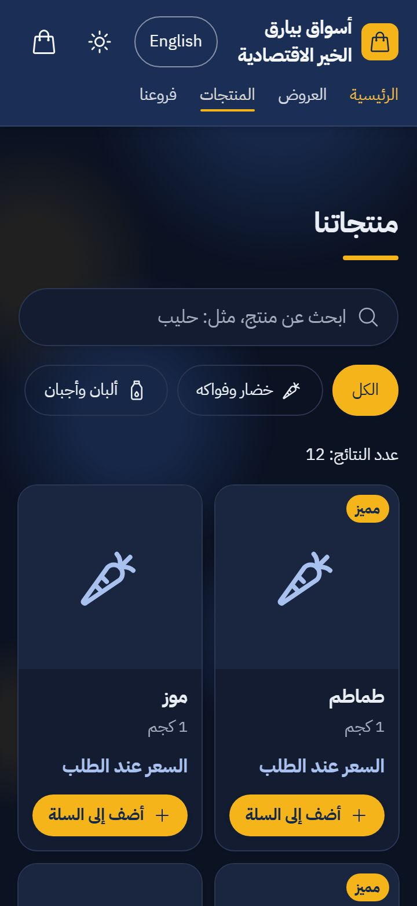
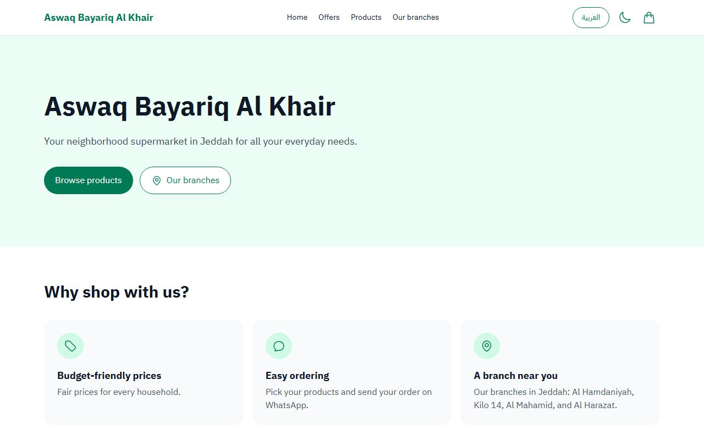

# أسواق بيارق الخير الاقتصادية · Aswaq Bayariq Al Khair

The website of a neighborhood supermarket in Al Hamdaniyah, Jeddah. Customers browse products and offers, find the store, and send their order on WhatsApp.

**Live site: [ahmedalsoufi14-4r4s.github.io/bayariq-website](https://ahmedalsoufi14-4r4s.github.io/bayariq-website/)**

<p>
  
  
</p>


## Features

- Arabic first (right to left), with an English switch. The choice is remembered.
- Product list with category filter and a search that ignores Arabic letter variants (أ إ آ, ة, ى) and diacritics.
- Offers with a "valid until" date. Expired offers hide themselves.
- Cart with quantities, a note for items that are not listed, and an order form. "Send order" opens WhatsApp with a ready message and an estimated total.
- Opening hours, address, map, and call and WhatsApp buttons.
- Dark mode, subtle animations (off for people who ask their device for less motion), keyboard friendly, AA contrast.
- Fast on phones: on the live site, Lighthouse mobile gives about 95 for Performance (89 to 98 across runs) and 100 for Accessibility, Best Practices and SEO.

## Tech

React and Vite, plain JavaScript, Tailwind CSS. No backend: all content is in JSON files. Unit tests with Vitest, browser checks with Playwright (Chromium). Hosted on GitHub Pages.

## Run it locally

You need Node.js 22.

```sh
npm install
npm run dev        # http://localhost:5173/bayariq-website/
```

| Command                | What it does                                                                                         |
| ---------------------- | ---------------------------------------------------------------------------------------------------- |
| `npm run dev`          | Starts the development server.                                                                       |
| `npm run build`        | Builds the site into `dist/`.                                                                        |
| `npm run lint`         | Checks the code with ESLint.                                                                         |
| `npm run format:check` | Checks the formatting with Prettier (`npm run format` fixes it).                                     |
| `npm test`             | Runs the unit tests (cart, WhatsApp message, Arabic search, offers, JSON-LD).                        |
| `npm run check`        | Builds the site and runs the Playwright checks in Arabic and English at 360 px and 1280 px.          |
| `npm run images`       | Remakes the share image, the iPhone icon and the README screenshots (after a logo or design change). |

The first `npm run check` needs Chromium: `npx playwright install chromium`.

## Change the content

All content lives in `src/data/` and `src/i18n/`. Nothing in the components needs to change.

| File                          | Holds                                                                               |
| ----------------------------- | ----------------------------------------------------------------------------------- |
| `src/data/store.json`         | Name, phone, WhatsApp number, opening hours, address, map links, delivery, website. |
| `src/data/products.json`      | Products: names in both languages, category, price (or `null`), unit, photo.        |
| `src/data/categories.json`    | Categories with an emoji icon.                                                      |
| `src/data/offers.json`        | Offers with a last day (`validUntil`, `YYYY-MM-DD`).                                |
| `src/i18n/ar.json`, `en.json` | Every text on the page, in Arabic and English.                                      |

Photos go in `public/images/` as WebP under 200 KB ([squoosh.app](https://squoosh.app) converts them for free). `npm run check` fails if a photo is missing, too big or not WebP.

Values tagged `NEEDS-AHMED` are still missing. The site hides them or shows "قريبًا / Coming soon" until they are filled in. [NEEDS_FROM_AHMED.md](NEEDS_FROM_AHMED.md) lists them all.

## Project structure

```text
src/
  sections/    page sections (hero, offers, products, store info)
  components/  smaller parts (header, cards, dialogs, cart drawer, order form)
  cart/        cart state, saved in the browser
  i18n/        language switch and all texts
  lib/         pure functions with unit tests
  data/        store details, products, categories, offers
e2e/           Playwright browser checks
scripts/       makes the share image, icon and screenshots
public/        favicon, share image, fonts, photos
```

## Deployment

Every push to `main` runs [.github/workflows/deploy.yml](.github/workflows/deploy.yml): lint, formatting, unit tests and the browser checks. Only when they all pass does it publish `dist/` to GitHub Pages. A mistake in a data file therefore never reaches the live site.

One-time setting in the repository: **Settings → Pages → Build and deployment → Source: GitHub Actions**.

## Credits

- Font: [IBM Plex Sans Arabic](https://github.com/IBM/plex) by IBM, SIL Open Font License ([public/fonts/OFL.txt](public/fonts/OFL.txt)).
- Icons: [Heroicons](https://heroicons.com) by Tailwind Labs, MIT license.
