# Product photos: check before the next round

284 of 15973 products have a photo so far, all from Open Food Facts. Every one was looked at twice. The POS export has no barcodes, so a photo was used only when the brand, the product and the size are the same.

To see all of them: the "Photo credits" page of the site (the link is in the footer). To remove a wrong one, delete its line from `public/data/photo-credits.json` and its file from `public/images/products/`, then run `npm run products`.

## The 18 featured products

| Photo                                                              | Product                                       | Source                                                                                                                                             |
| ------------------------------------------------------------------ | --------------------------------------------- | -------------------------------------------------------------------------------------------------------------------------------------------------- |
| 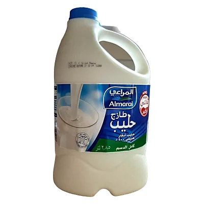 | حليب المراعي طازج 2.85 لتر                    | [Open Food Facts](https://world.openfoodfacts.org/product/6281007034043) (CC BY-SA 3.0)                                                            |
| –                                                                  | لبن المراعي طازج كامل الدسم 1 لتر             | Category picture. The photo found is the carton, and the POS has two 1 L full-fat labans (1032407 and 1031071): not clear which one is the carton. |
| –                                                                  | حليب نيدو بودرة 1800 جم                       | Category picture. Only the pouch was found, and the POS name does not say tin or pouch.                                                            |
| –                                                                  | بيض طازج غذاء البركة نص طبق 15 حبة            | Category picture. No photo of this brand of eggs.                                                                                                  |
| –                                                                  | جبنة بوك قابلة للدهن فيتامين 500 جم           | Category picture. No photo shows the vitamin version, and Puck’s website forbids reuse.                                                            |
| –                                                                  | رز ابو كاس مزة بسمتي 5 كيلو                   | Category picture. Abu Kass’s photo is all rights reserved: waiting for the company’s permission.                                                   |
| –                                                                  | سكر الاسرة خشن 5 كجم                          | Category picture. No photo of the coarse 5 kg bag.                                                                                                 |
| –                                                                  | زيت ذرة عافية 3 (2 * 1.5 لتر + 2 * 500 مل)    | Category picture. A bundle (2 × 1.5 L + 2 × 500 ml): no photo of the bundle.                                                                       |
| –                                                                  | دجاج الوطنية مبرد 1000 جم                     | Category picture. No photo, and the Al Watania website did not answer.                                                                             |
| 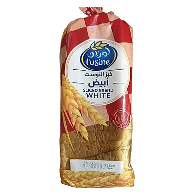 | خبز التوست لوزين ابيض 600 جم                  | [Open Food Facts](https://world.openfoodfacts.org/product/6281007060257) (CC BY-SA 3.0)                                                            |
| –                                                                  | اندومي بنكهة الدجاج اوبامي 75 جم              | Category picture. "اوبامي" may be another brand than Indomie: not clear.                                                                           |
| –                                                                  | شاي ربيع إكسبرس المذاق الاصلي خيط 24 * 25 خيط | Category picture. Rabea’s photo is all rights reserved: waiting for the company’s permission.                                                      |
| –                                                                  | قهوة عربية المرسال (الخير) 500 جم             | Category picture. No photo, and no official website found.                                                                                         |
| –                                                                  | تمر سكري القصيم انيسة 1 كجم                   | Category picture. No photo, and no official website found.                                                                                         |
| –                                                                  | مياة نوفا كبير 1.5 لتر                        | Category picture. No photo of the 1.5 L bottle, and Nova’s website shows other sizes only.                                                         |
| –                                                                  | بيبسي بلاستيك وسط 1 لتر                       | Category picture. Only the Jordanian and Egyptian 1 L bottles were found.                                                                          |
| –                                                                  | صابون تايد اخضر اوتوماتيك 1.5 كيلو            | Category picture. Not food, so not in Open Food Facts, and P&G’s website forbids reuse.                                                            |
| –                                                                  | مناديل فاين وجه فلافي 9 * 4 * 130 منديل       | Category picture. Not food, so not in Open Food Facts, and Fine’s website forbids reuse.                                                           |

## 20 photos to check

Is it the same brand, product and size as on your shelf?

| #   | Photo                                                              | Product                                      | Category             | Open Food Facts                                                                |
| --- | ------------------------------------------------------------------ | -------------------------------------------- | -------------------- | ------------------------------------------------------------------------------ |
| 1   | 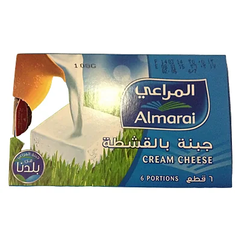 | جبنة بالقشطة مربعات المراعي 108 جم           | Dairy & Cheese       | [barcode 6281007023955](https://world.openfoodfacts.org/product/6281007023955) |
| 2   | 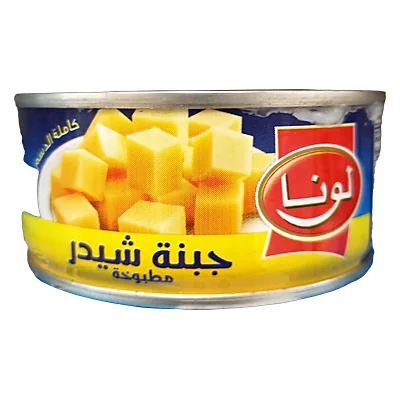 | جبنة لونا شيدر علب وسط 113 جم                | Dairy & Cheese       | [barcode 6281020320932](https://world.openfoodfacts.org/product/6281020320932) |
| 3   | 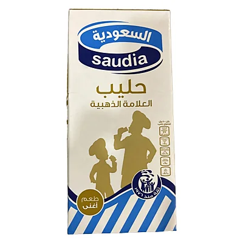 | حليب السعودية ذهبى 1 لتر                     | Dairy & Cheese       | [barcode 6281039107012](https://world.openfoodfacts.org/product/6281039107012) |
| 4   | 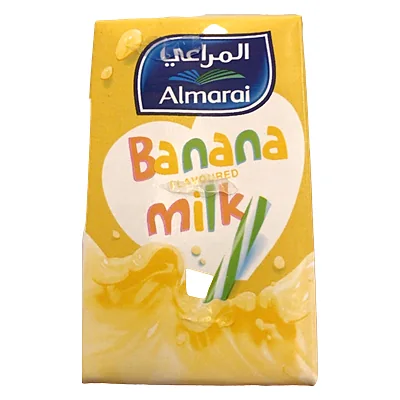 | حليب المراعي ماهر صغير بالموز 150 مل         | Dairy & Cheese       | [barcode 6281007038980](https://world.openfoodfacts.org/product/6281007038980) |
| 5   | 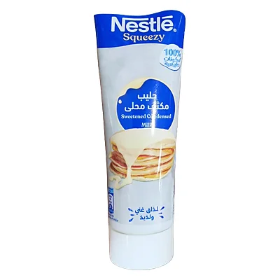 | حليب مكثف محلي نستلة 170 جم                  | Dairy & Cheese       | [barcode 8445291560147](https://world.openfoodfacts.org/product/8445291560147) |
| 6   | 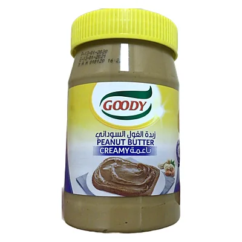 | زبدة الفول السوداني قودي ناعم وسط 510 جم     | Dairy & Cheese       | [barcode 6281014110020](https://world.openfoodfacts.org/product/6281014110020) |
| 7   | 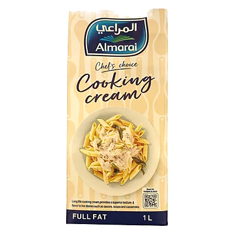 | كريمة الطبخ المراعي كامل الدسم 1 لتر         | Dairy & Cheese       | [barcode 6281007031776](https://world.openfoodfacts.org/product/6281007031776) |
| 8   | 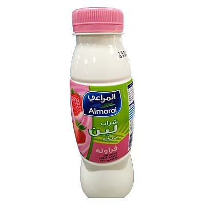 | لبن المراعي فراولة 340 مل                    | Dairy & Cheese       | [barcode 6281007047500](https://world.openfoodfacts.org/product/6281007047500) |
| 9   | 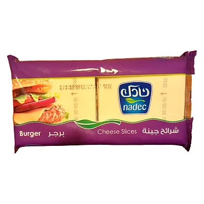 | نادك جبنة شرائح برجر 400 جم                  | Dairy & Cheese       | [barcode 6281057007318](https://world.openfoodfacts.org/product/6281057007318) |
| 10  | 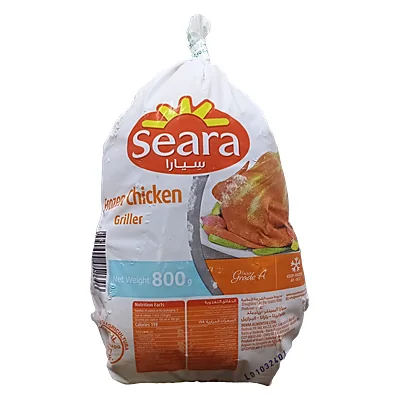 | دجاج مجمد برازيلي سيارا 800 جرام             | Frozen Food          | [barcode 7894904052646](https://world.openfoodfacts.org/product/7894904052646) |
| 11  | 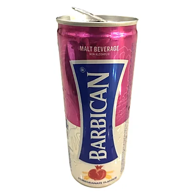 | بيره بربيكان رمان علب 250 مل                 | Beverages & Water    | [barcode 6297000747767](https://world.openfoodfacts.org/product/6297000747767) |
| 12  | 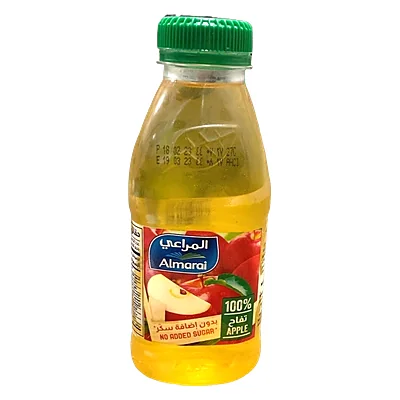 | عصير المراعي تفاح صغير 200 مل                | Beverages & Water    | [barcode 6281007055321](https://world.openfoodfacts.org/product/6281007055321) |
| 13  | 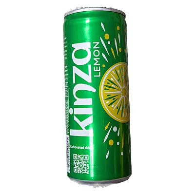 | مشروب غازي كينزا ليمون 250 مل                | Beverages & Water    | [barcode 6287034100041](https://world.openfoodfacts.org/product/6287034100041) |
| 14  | 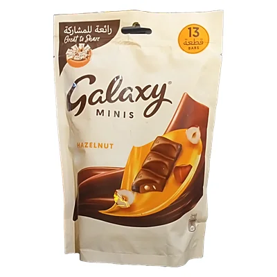 | جلاكسي بالبندق 162.5 غرام مينيز اكياس عربي   | Sweets & Snacks      | [barcode 6294001832638](https://world.openfoodfacts.org/product/6294001832638) |
| 15  | 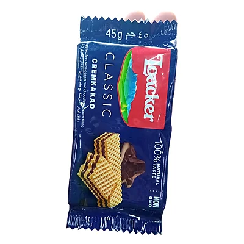 | لواكر كلاسيك ويفر كاكاو 45 جم                | Sweets & Snacks      | [barcode 02537544](https://world.openfoodfacts.org/product/02537544)           |
| 16  | 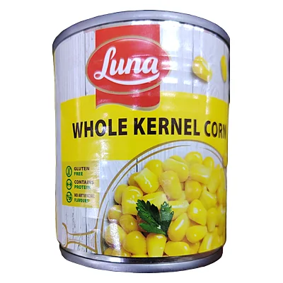 | ذرة حب كاملة حلوة لونا 185 جرام              | Canned Food & Sauces | [barcode 6281020333130](https://world.openfoodfacts.org/product/6281020333130) |
| 17  | 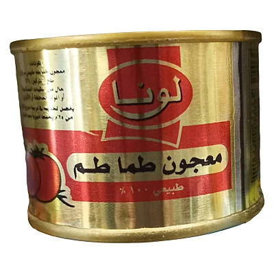 | صلصة لونا علب صغير 70 جم                     | Canned Food & Sauces | [barcode 6281020101111](https://world.openfoodfacts.org/product/6281020101111) |
| 18  | 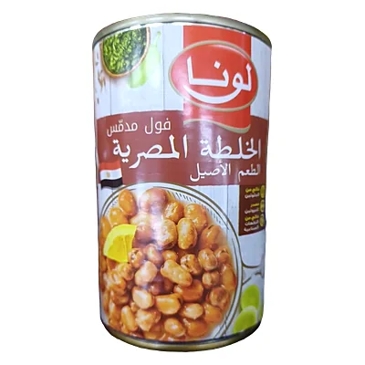 | فول مدمس لونا خلطة مصرية 450 جم              | Canned Food & Sauces | [barcode 6281020325630](https://world.openfoodfacts.org/product/6281020325630) |
| 19  | 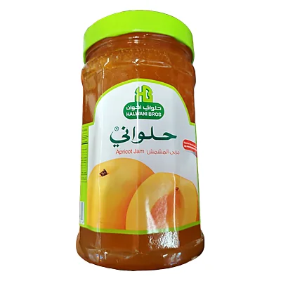 | مربى حلواني مشمش كبير 800 جم                 | Canned Food & Sauces | [barcode 6281041236816](https://world.openfoodfacts.org/product/6281041236816) |
| 20  | 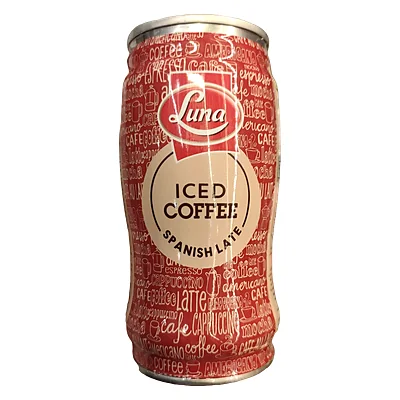 | لونا قهوة مثلجة أيس كوفي سبانيش لاتية 240 مل | Tea, Coffee & Grains | [barcode 6281020173965](https://world.openfoodfacts.org/product/6281020173965) |

## Photos by category

| Category                     | With a photo | With the category picture |
| ---------------------------- | ------------ | ------------------------- |
| Dairy & Cheese               | 125          | 971                       |
| Frozen Food                  | 22           | 970                       |
| Beverages & Water            | 38           | 1167                      |
| Sweets & Snacks              | 26           | 2641                      |
| Canned Food & Sauces         | 53           | 1516                      |
| Oils & Ghee                  | 6            | 223                       |
| Tea, Coffee & Grains         | 9            | 720                       |
| Attara: Spices, Nuts & Herbs | 5            | 488                       |
| Cleaning & Household         | 0            | 1243                      |
| Personal Care & Beauty       | 0            | 1320                      |
| Baby Care                    | 0            | 222                       |
| Paper & Disposables          | 0            | 1471                      |
| Housewares & Kitchen         | 0            | 1570                      |
| Electrical & Hardware        | 0            | 396                       |
| Accessories & Electronics    | 0            | 262                       |
| Toys & Stationery            | 0            | 379                       |
| Clothing & Linens            | 0            | 56                        |
| Gifts & Party                | 0            | 74                        |
| **All**                      | **284**      | **15689**                 |
