# Product photos: check before the next round

502 of 15973 products have a photo now (round 1: 280 still on the site, round 2: 222 new). 484 come from Open Food Facts, 15 from Open Beauty Facts and 3 from Open Products Facts, all under CC BY-SA 3.0 and all listed on the "Photo credits" page (the link is in the footer).

To remove a wrong one, delete its line from `public/data/photo-credits.json` and its file from `public/images/products/`, then run `npm run products`.

## How round 2 was checked

The POS export still has no barcodes, so every match went through these steps:

1. **Text on the pack.** Open Food Facts keeps the text of every photo (read by OCR). The Gulf products of all three databases were matched on the words of the POS name and on the size, and only pairs whose size is printed on a photo of the same barcode went on.
2. **First look:** about 1,800 candidate barcodes on review sheets, keeping only those where brand, product and variant agree (ذهبي، كامل الدسم / قليل الدسم / خالي، the flavor, علبة / كيس / زجاج).
3. **Second look at full size:** the photo next to the place on the pack where the size is printed. Out went every photo whose size was only on a shelf tag or in the database, or whose label didn't show the variant. Also out: another shop's price sticker or price tag on the pack, a legible production or expiry date, a pack that is cut off, and packshots that look like a manufacturer's or another shop's picture.
4. **Third look at the finished 400 × 400 photo:** out went those where a hand still showed, the cut-out broke the pack (many frozen-food boxes), or the colors were wrong.

The first look kept 573 product–barcode pairs from Open Food Facts, and 445 of them had their size printed on a photo; from Open Beauty Facts and Open Products Facts, 177 records were read at full size. 222 photos passed every look.

## The 4 photos you asked about

| #   | Product                              | Result                                                                                                                                                              |
| --- | ------------------------------------ | ------------------------------------------------------------------------------------------------------------------------------------------------------------------- |
| 3   | حليب السعودية ذهبى 1 لتر             | **Kept.** The front reads "حليب العلامة الذهبية" (gold label). The size is not printed on that side: the shape of the 1 L carton and the barcode's 1 L entry match. |
| 4   | حليب المراعي ماهر صغير بالموز 150 مل | **Removed.** The pack says "Banana flavoured milk" and 150 ml (in the nutrition facts), but "ماهر" appears nowhere on it.                                           |
| 7   | كريمة الطبخ المراعي كامل الدسم 1 لتر | **Kept.** "FULL FAT" and "1 L" are printed on the front.                                                                                                            |
| 20  | لونا قهوة مثلجة سبانيش لاتية 240 مل  | **Kept.** "ICED COFFEE / SPANISH LATE" is printed on the can.                                                                                                       |

## Also removed from round 1

| Product                            | Why                                                                                                                                                  |
| ---------------------------------- | ---------------------------------------------------------------------------------------------------------------------------------------------------- |
| جبنة بالقشطة مربعات المراعي 108 جم | Sample #1: the printed production and expiry dates (P 14 03 14, E 08 01 15) can be read in the finished photo.                                       |
| جبنة فيتا المراعي كامل الدسم 200جم | The "photo" is Almarai's own packshot (a drawing on white), uploaded to Open Food Facts by someone else. Almarai's pictures are all rights reserved. |
| كريمة خفق المراعي 500 مل           | Same: Almarai's own packshot.                                                                                                                        |

Round 2 turned up two Open Food Facts uploads carrying a supermarket's watermark, so the original photos of round 1 were looked over again (as thumbnails, then the white-background ones at full size). Only these two packshots were found.

## Rabea and Abu Kass

No openly licensed photo of these exact products was found, so both keep the category drawing.

- **شاي ربيع إكسبرس المذاق الاصلي (25 خيط):** Open Food Facts has one 25-bag Rabea Express box (barcode 6281013233003), but it reads "Rich Flavor and Smooth Taste" (the older box), not "المذاق الأصلي".
- **رز ابو كاس مزة بسمتي 5 كيلو:** the only 5 kg bag (barcode 6281100410072) reads "أرز مزة هندي بسمتي", and the POS has "مزة هندي" as a separate product. The front photo also cuts the bag off.
- Wikimedia Commons has no photo of either.

## Featured products

Still 2 of 18 with a photo (حليب المراعي طازج 2.85 لتر and خبز التوست لوزين ابيض 600 جم). For the other 16, no photo passed. The notes from round 1 still apply, and Tide (صابون تايد اخضر اوتوماتيك 1.5 كيلو) and Fine (مناديل فاين وجه فلافي) are not in Open Products Facts or Open Beauty Facts with the same pack and size either.

## 20 non-food photos to check

Is it the same brand, product, variant and size as on your shelf?

| #   | Photo                                                              | Product                                        | Category               | Source                                                                                                  |
| --- | ------------------------------------------------------------------ | ---------------------------------------------- | ---------------------- | ------------------------------------------------------------------------------------------------------- |
| 1   | 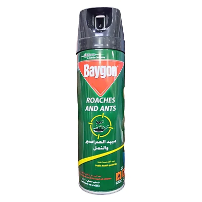 | بايجون بخاخ مبيد الصراصير والنمل 300 مل        | Cleaning & Household   | [Open Food Facts, barcode 6281100874836](https://world.openfoodfacts.org/product/6281100874836)         |
| 2   | 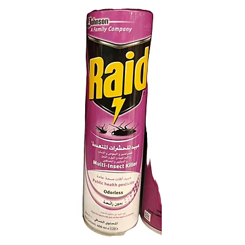 | ريد مبيد للحشرات المتعددة بدون رائحة 400 مل    | Cleaning & Household   | [Open Food Facts, barcode 6281100874911](https://world.openfoodfacts.org/product/6281100874911)         |
| 3   | 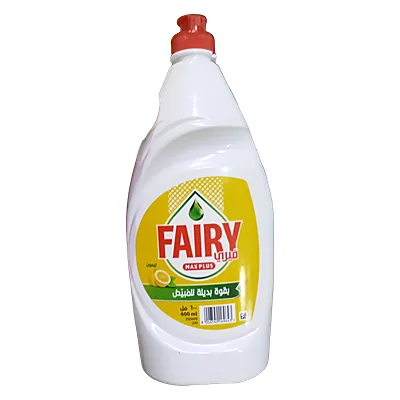 | فيري بلس ليمون 600 مل                          | Cleaning & Household   | [Open Food Facts, barcode 8006540169643](https://world.openfoodfacts.org/product/8006540169643)         |
| 4   | 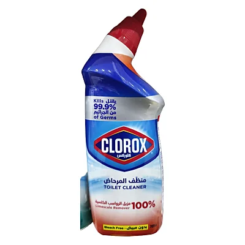 | كلوركس منظف المرحاض بدون مبيض 709 مل           | Cleaning & Household   | [Open Food Facts, barcode 6281065018887](https://world.openfoodfacts.org/product/6281065018887)         |
| 5   | 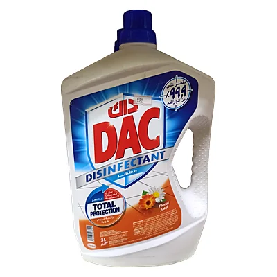 | مطهر ارضيات داك ازهار 3 لتر                    | Cleaning & Household   | [Open Products Facts, barcode 6281031263792](https://world.openproductsfacts.org/product/6281031263792) |
| 6   | 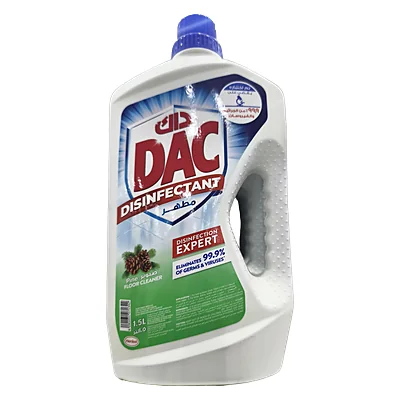 | مطهر ارضيات داك صنوبر صغير 1.5 لتر             | Cleaning & Household   | [Open Food Facts, barcode 6281031071342](https://world.openfoodfacts.org/product/6281031071342)         |
| 7   | 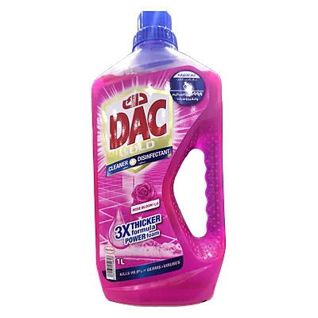 | مطهر ارضيات داك قولد ورد 1 لتر                 | Cleaning & Household   | [Open Food Facts, barcode 6281031254608](https://world.openfoodfacts.org/product/6281031254608)         |
| 8   | 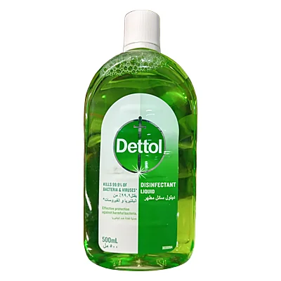 | مطهر ديتول سائل 500 مل                         | Cleaning & Household   | [Open Food Facts, barcode 5000158063228](https://world.openfoodfacts.org/product/5000158063228)         |
| 9   | 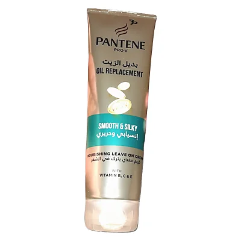 | بانتين برو في بديل الزيت انسيابي وحريري 275 مل | Personal Care & Beauty | [Open Beauty Facts, barcode 8001090151780](https://world.openbeautyfacts.org/product/8001090151780)     |
| 10  | 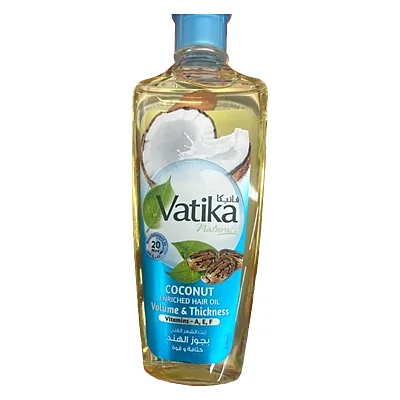 | زيت شعر دابر فاتيكا زيت جوز الهند 200 مل       | Personal Care & Beauty | [Open Beauty Facts, barcode 6291069651058](https://world.openbeautyfacts.org/product/6291069651058)     |
| 11  | 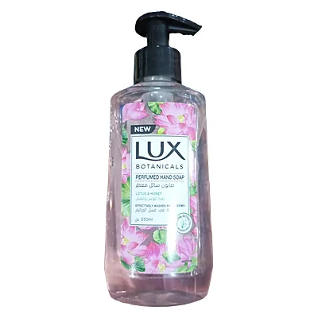 | سائل يد لوكس زهرة اللوتس والعسل 250 مل         | Personal Care & Beauty | [Open Food Facts, barcode 6281006519817](https://world.openfoodfacts.org/product/6281006519817)         |
| 12  | 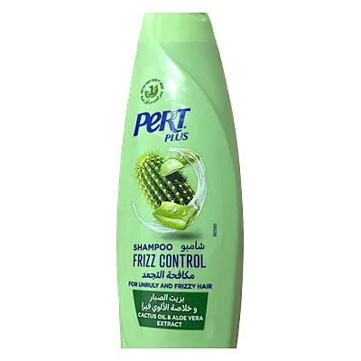 | شامبو برت بلاس زيت الصبار والويفيرا 400 جم     | Personal Care & Beauty | [Open Beauty Facts, barcode 4015100426823](https://world.openbeautyfacts.org/product/4015100426823)     |
| 13  | 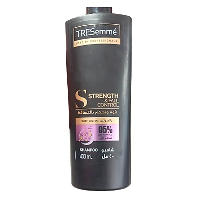 | شامبو تريسمي قوة وتحكم 400 مل                  | Personal Care & Beauty | [Open Beauty Facts, barcode 6281006534865](https://world.openbeautyfacts.org/product/6281006534865)     |
| 14  | 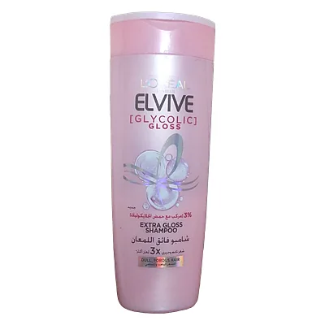 | شامبو لوريال جليكوليك جلوس 400 مل              | Personal Care & Beauty | [Open Beauty Facts, barcode 3610340673801](https://world.openbeautyfacts.org/product/3610340673801)     |
| 15  | 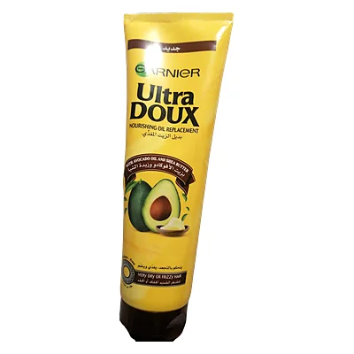 | غارنير بديل الزيت الافوكادو وزبدة الشيا 300مل  | Personal Care & Beauty | [Open Beauty Facts, barcode 3610340026089](https://world.openbeautyfacts.org/product/3610340026089)     |
| 16  | 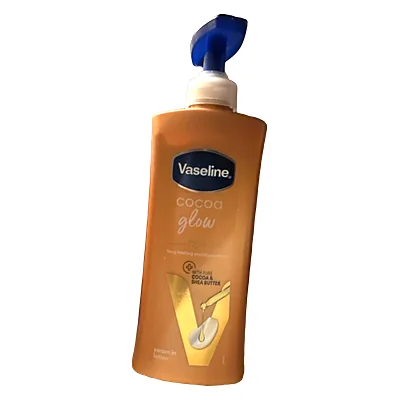 | لوشن فازلين بالكاكاو 400 مل                    | Personal Care & Beauty | [Open Beauty Facts, barcode 4792081013777](https://world.openbeautyfacts.org/product/4792081013777)     |
| 17  | 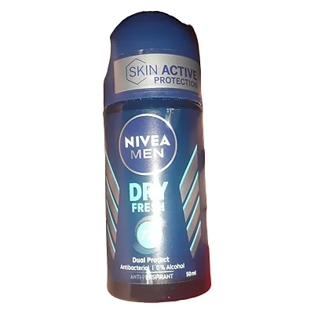 | نيفيا رول للرجال دراي فرش 50 مل                | Personal Care & Beauty | [Open Beauty Facts, barcode 4005344485243](https://world.openbeautyfacts.org/product/4005344485243)     |
| 18  | 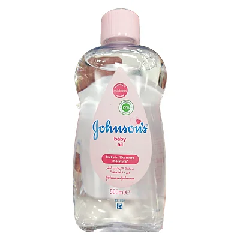 | زيت جونسون للاطفال 500 مل                      | Baby Care              | [Open Food Facts, barcode 8410207140409](https://world.openfoodfacts.org/product/8410207140409)         |
| 19  | 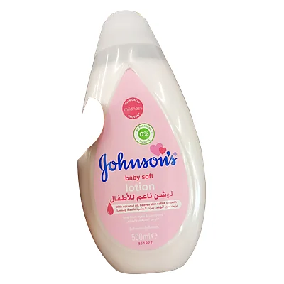 | لوشن ناعم جونسون للاطفال 500 مل                | Baby Care              | [Open Products Facts, barcode 3574669908023](https://world.openproductsfacts.org/product/3574669908023) |
| 20  | 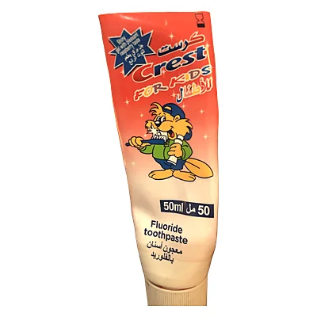 | معجون اسنان كرست اطفال 50 مل                   | Baby Care              | [Open Beauty Facts, barcode 5000174455915](https://world.openbeautyfacts.org/product/5000174455915)     |

Two things to know about the non-food photos:

- Only 37 non-food products have a photo. Most of the beauty and household records have one shelf photo that doesn't show the size, and none were found for paper, housewares, electrical, toys, clothing or gifts.
- #16 (cocoa) is the newer "Cocoa Glow" bottle. It says 400 ml (on the back, in Arabic too), but if your shelf has the older "Cocoa Radiant" bottle, the look differs.

## A decision for you: round 1 sizes

Round 2 used a stricter rule than round 1: the size has to be printed on a photo of the same barcode. When the round 1 photos are checked the same way (by OCR), 139 of 280 show their size. For the other 141, the size comes from the database entry of the barcode (for example #3, the Saudia gold milk). OCR misses small or curved text, so many of them are probably fine. Tell me whether to keep them, or to look at them one by one and remove those whose size can't be read.

## Photos by category

| Category                     | With a photo | With the category picture |
| ---------------------------- | ------------ | ------------------------- |
| Dairy & Cheese               | 179          | 917                       |
| Frozen Food                  | 39           | 953                       |
| Beverages & Water            | 70           | 1135                      |
| Sweets & Snacks              | 59           | 2608                      |
| Canned Food & Sauces         | 84           | 1485                      |
| Oils & Ghee                  | 10           | 219                       |
| Tea, Coffee & Grains         | 17           | 712                       |
| Attara: Spices, Nuts & Herbs | 7            | 486                       |
| Cleaning & Household         | 14           | 1229                      |
| Personal Care & Beauty       | 17           | 1303                      |
| Baby Care                    | 6            | 216                       |
| Paper & Disposables          | 0            | 1471                      |
| Housewares & Kitchen         | 0            | 1570                      |
| Electrical & Hardware        | 0            | 396                       |
| Accessories & Electronics    | 0            | 262                       |
| Toys & Stationery            | 0            | 379                       |
| Clothing & Linens            | 0            | 56                        |
| Gifts & Party                | 0            | 74                        |
| **All**                      | **502**      | **15471**                 |
